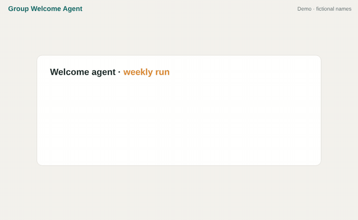
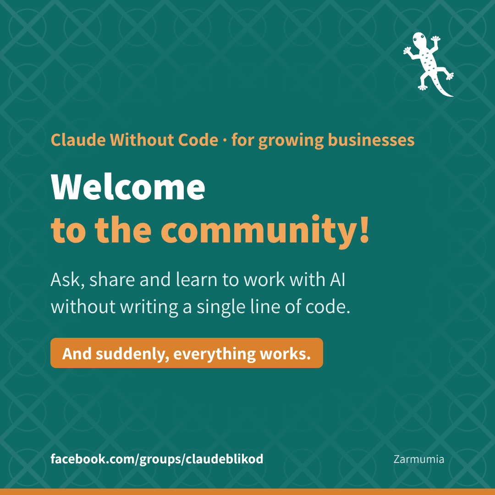
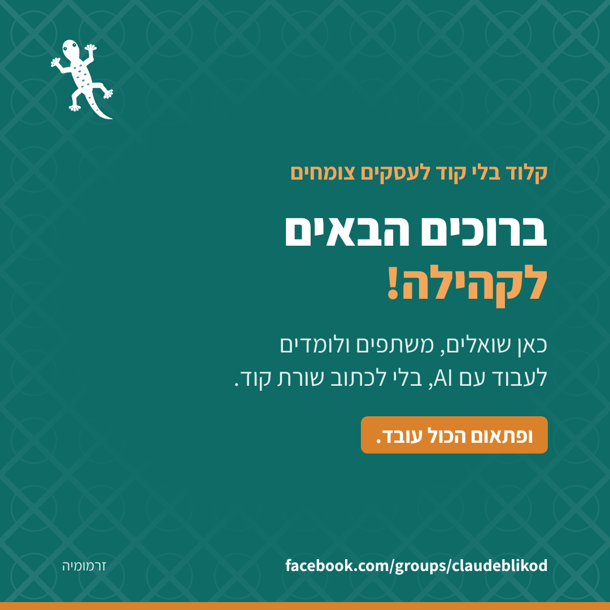
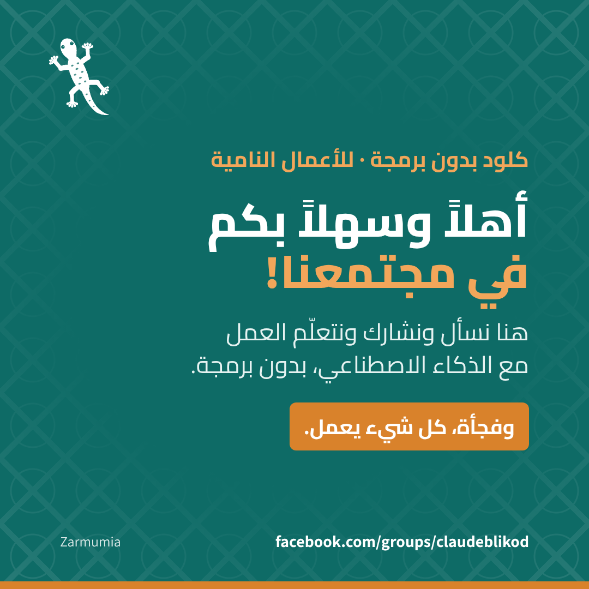

# Group Welcome Agent 👋

**A personal, branded welcome for every new member of your Facebook group, with a human approving every post.**

סוכן AI שמכין ברוכים הבאים אישי וממותג לכל מצטרף חדש לקבוצת פייסבוק, ואדם מאשר כל פוסט.

Built by [Zarmumia](https://zarmumia.co.il) for the community [קלוד בלי קוד לעסקים צומחים](https://www.facebook.com/groups/claudeblikod).

---

## Why

- **Works without the Groups API.** Meta retired it, so Zapier and Make can't post to groups. This agent works in the browser instead, the way a community manager would.
- **Personal, not generic.** Each new member greeted by first name, in your group's language, with a welcome image in your brand, instead of Facebook's built-in list of names.
- **A human clicks Post.** The agent prepares everything and stops. You review, edit if you want, and publish.

**Who it's for:** coaches, course creators and community builders who use a free Facebook group to grow a paid program.

## How it works



```
Every week, or every day (scheduled Claude task)
        │
        ▼
Opens the group's members page in Chrome (Claude in Chrome)
        │
        ▼
Finds who joined since the last run ── none? ──► "no new members" notification
        │
        ▼
Writes the new members' first names in the group's language,
        │   adds a post worth reading, the next icebreaker and the image
        │
        ▼
Stops before "Post" and sends a notification
        │
        ▼
The admin reviews and clicks "Post" (≈10 seconds)
```

## What it does that Facebook doesn't

| | Facebook's weekly welcome | This agent |
|---|---|---|
| Greeting | Fixed English template | Hebrew, Arabic or English, with first names in the group's language |
| Image | None | A fixed branded welcome card (optionally with the new members' first names) |
| Personal touch | Name tags only | First names in the group's language. No profile visits, no guesses about anyone |
| Next step | — | Points new members to one existing post worth reading |
| Icebreaker | — | A rotating question each time, so welcomes never feel copy-pasted |
| Frequency | Weekly | Weekly for small groups, daily for large ones |

<p align="center">
  
  
  
</p>
<p align="center"><sub>Same card in English (LTR), Hebrew and Arabic (RTL)</sub></p>

## Human in the loop, on purpose

The agent never publishes by itself. Posting in a community is speaking in someone's name,
so the last click stays human. The agent does the boring part; the admin keeps the voice.

## What's in the repo

| Path | What it is |
|---|---|
| `prompt.md` | The instruction the scheduled task runs each week |
| `assets/welcome*.png` | Fixed welcome cards: Hebrew, English, Arabic (1080×1080) |
| `template/` | HTML template + Playwright script to re-render the image in your own brand |

## Quick start (no code)

The welcome cards in `assets/` are ready to use, so there's nothing to install or run.

1. Copy `prompt.md`.
2. Replace the group URL and the texts with your own.
3. In Claude, create a weekly scheduled task with that prompt, on a computer with Claude in Chrome.

That's it. Each run ends with a notification, you take a look, and you click **Post**.

Want the card in your own brand? See *Make it yours* below.

## Make it yours (optional)

To re-render the card in your own brand, edit `template/card.html` (colors, logo, text) and run:

```bash
npm i playwright
node template/render.js              # Hebrew (RTL)
node template/render.js --lang en    # English (LTR)
node template/render.js --lang ar    # Arabic (RTL)
```

## Requirements

- Claude with scheduled tasks and Claude in Chrome
- The computer on, with Chrome open, at run time
- Admin access to the group

## Want it set up for your group?

Zarmumia installs and adapts this agent for communities and businesses: your brand, your language, your group.

→ [zarmumia.co.il](https://zarmumia.co.il)

Questions or ideas? Join [קלוד בלי קוד לעסקים צומחים](https://www.facebook.com/groups/claudeblikod) or open an issue.

---

Fonts: [Assistant](https://fonts.google.com/specimen/Assistant) and [Cairo](https://fonts.google.com/specimen/Cairo) (SIL Open Font License).
Arabic texts are a starting point; have a native speaker review them before using them with clients.
Code: MIT.

**Zarmumia · ופתאום הכול עובד.**
